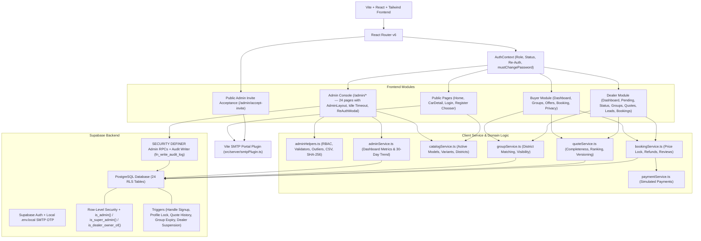

# Group Car Buying Platform - Architecture & Codebase Overview

> Architectural Summary & Module Topology (`graphify.detect` inventory: 165 files, 127 code modules)

The **Group Car Buying Platform** connects prospective car buyers in the same district seeking the exact same vehicle variant into aggregated purchasing groups. Verified dealerships compete with itemized on-road quotations. Buyers can signal non-binding interest or lock in their price via simulated booking, while platform administrators govern dealership verification, buyer/group integrity, moderation, platform rules, and immutable auditing.

---

## 1. High-Level System Architecture



---

## 2. Directory Structure & Modular Breakdown

```
D:\group-car-buying
├── docs/
│   ├── architecture.md           # System topology & business rules reference
│   ├── auth-setup.md             # .env.local SMTP OTP, Supabase auth & admin provisioning guide
│   ├── progress.md               # Milestone & admin task tracker
│   ├── test-report.md            # Unit, SQL RLS & Playwright E2E verification report
│   ├── email-templates/          # HTML/TXT 6-digit OTP templates
│   └── screenshots/              # Verified 360px, 768px & 1440px Playwright captures
├── scripts/
│   ├── db-admin-ops.mjs          # Zero-secret pg/GoTrue CLI helper for schema checks & account setup
│   ├── configure-auth-nonsecret.mjs # Applies Site URL & Confirm email setting via Management API
│   └── run-remote-setup.ps1      # Fail-fast PowerShell runner using session env vars only
├── src/
│   ├── server/
│   │   └── smtpPlugin.ts         # Local Express/Vite middleware for /api/auth/send-otp & verify-otp
│   ├── components/
│   │   ├── admin/
│   │   │   ├── AdminCharts.tsx   # 30-day SVG trend chart (signups, groups, bookings)
│   │   │   ├── AdminLayout.tsx   # Sidebar shell, breadcrumbs, session badge, 30m idle timeout
│   │   │   ├── DataTable.tsx     # Sticky headers, sorting, pagination, skeleton/empty/error states
│   │   │   └── ReAuthModal.tsx   # Password verification + mandatory audit reason dialog
│   │   ├── auth/
│   │   │   ├── OtpVerification.tsx
│   │   │   └── ProtectedRoute.tsx # Enforces buyer/dealer/admin/super_admin, 403 & forced pw change
│   │   ├── feature/
│   │   │   └── CarIllustration.tsx
│   │   ├── layout/               # Navbar, Footer, BuyerLayout, DealerLayout
│   │   └── ui/                   # Button, Card, Badge, Modal, Input, Select, Tabs, Toast, Skeleton
│   ├── context/
│   │   └── AuthContext.tsx
│   ├── lib/
│   │   ├── adminHelpers.ts
│   │   ├── adminService.ts
│   │   ├── bookingService.ts
│   │   ├── catalogService.ts
│   │   ├── formatters.ts
│   │   ├── groupService.ts
│   │   ├── paymentService.ts
│   │   ├── quoteService.ts
│   │   └── supabase.ts
│   ├── pages/
│   │   ├── admin/                # All 24 Admin Console & Auth Flow screens
│   │   ├── auth/                 # Login, Register Chooser, Buyer/Dealer Reg, Verify OTP, Forgot Password
│   │   ├── buyer/                # Buyer dashboard, groups, offers comparison, checkout, bookings, privacy
│   │   ├── dealer/               # Dealer dashboard, pending, status, groups, quotes, quote submit, leads, bookings, staff
│   │   └── public/               # HomePage, CarDetailPage
│   └── types/
│       └── database.ts
├── supabase/
│   ├── functions/send-admin-invite/ # Optional Deno Edge Function for automated invite emails
│   ├── migrations/
│   │   ├── 001_initial_schema.sql
│   │   ├── 002_rls_policies.sql
│   │   ├── 003_auth_user_trigger.sql
│   │   ├── 004_reliable_profile_trigger.sql
│   │   ├── 005_dealer_verification_and_admin.sql
│   │   ├── 006_admin_module.sql
│   │   ├── 007_fix_dealer_users_rls_recursion.sql
│   │   └── 008_platform_integrity_and_fixes.sql
│   ├── tests/
│   │   ├── rls_and_business_rules.sql
│   │   └── admin_rls_and_rules.sql
│   ├── cleanup_test_data.sql     # Targeted cleanup of synthetic @autogroup.in fixtures
│   ├── make_first_admin.sql      # Documented SQL fallback to promote first super_admin
│   ├── seed.sql                  # Real districts, manufacturers, models & variants catalog
│   ├── seed_demo.sql             # Optional demonstration data
│   ├── test_setup.sql            # Configures 6 standardized E2E test accounts
│   └── RUN_ME_FIRST.md
└── tests/
    ├── unit/business-rules.spec.ts
    ├── e2e.spec.ts
    └── admin.e2e.spec.ts
```

---

## 3. Core Business Rules & Security Architecture

### 3.1 Group Visibility & Expiry Rules
- A group becomes visible to verified dealerships once it reaches `visibility_member_threshold` (default `3`) active members, OR after `group_visibility_days_for_2_members` (default `20` days) with 2 members (`fn_is_group_visible_to_dealers`).
- Rapid joins exceeding `suspicious_group_member_threshold` (default `5`) within `suspicious_group_window_minutes` (default `60`) flag `groups.is_suspicious = true`.
- Unformed 1-member groups older than `group_expiry_days_for_1_member` (default `45` days) are expired via `fn_expire_1_member_groups()`.

### 3.2 Quotation Integrity & Outlier Detection
- Quotations omitting mandatory insurance or registration are marked `is_complete = false` and excluded from lowest-price badges and savings comparisons.
- All price edits log immutable rows into `quotation_versions`.
- Quotes deviating from the complete group median by >= `quote_outlier_threshold_percent` (default `15%`) are highlighted in `/admin/quotations`.

### 3.3 Admin Role Hierarchy, RLS & Audit Trail
- Roles: `super_admin` (full control, admin invites/management, platform settings), `admin` (operations, moderation, read-only settings), `dealer`, `buyer`.
- Signup triggers restrict public self-signup metadata strictly to `'buyer'` or `'dealer'`.
- Helper functions `is_admin()`, `is_super_admin()`, `is_dealer_owner_of()`, and `fn_is_group_visible_to_dealers()` execute as `SECURITY DEFINER` to eliminate RLS recursion (`42P17`) while keeping read/write checks isolated.
- Direct client updates to sensitive columns (`profiles.role`, `profiles.status`, `must_change_password`, `dealerships.status`, direct booking status changes) are blocked by triggers; sensitive buyer, dealer, and admin workflows run through `SECURITY DEFINER` RPCs (`create_buying_group`, `join_buying_group`, `leave_buying_group`, `cancel_booking_atomic`, `confirm_booking_delivery`, `get_dealer_staff`, `manage_dealer_staff`, `get_group_member_summaries`, `get_group_public_metrics`, and `admin_*` RPCs in `006`/`008`) that validate state transitions and write audit entries cleanly.
- Last active `super_admin` cannot be demoted, deactivated, or deleted.
- Sensitive admin actions require password re-authentication (`ReAuthModal`) and audit reason logging.
- Admin sessions enforce a configurable 30-minute idle timeout with a 1-minute warning prompt.

### 3.4 Invitations, Settings & CSV Safety
- `admin_invites` stores only SHA-256 hashes (`token_hash`) of single-use 7-day tokens, rate-limited to 10/hour per `super_admin`.
- Pre-existing buyer/dealer emails are blocked from accepting admin invites unless `convert_existing = true` is explicitly set.
- `booking_amount + platform_fee < 10000` INR is enforced at both UI validation (`validatePlatformSetting`) and DB (`admin_update_setting` + `chk_total_booking_fee`).
- CSV exports escape quotes and neutralize leading `=`, `+`, `-`, `@` spreadsheet formula triggers (`buildCsvContent`), and log each export via `admin_log_export`.
