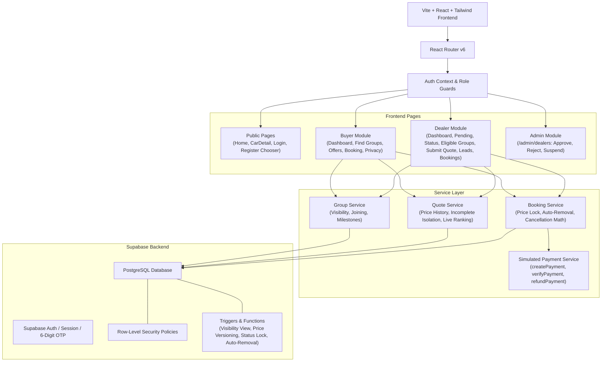

# Group Car Buying Platform - Architecture & Codebase Overview

> Graphify Architectural Summary & System Topology

The **Group Car Buying Platform** connects prospective car buyers in the same district seeking the exact same vehicle variant into aggregated purchasing groups. Licensed dealerships compete to provide transparent on-road quotations. Buyers can signal non-binding interest or lock in their price via simulated booking.

---

## 1. High-Level System Architecture



---

## 2. Directory Structure & Modular Breakdown

```
D:\group-car-buying
├── docs/
│   ├── architecture.md           # Graphify architectural overview & system topology
│   ├── auth-setup.md             # Supabase dashboard, 6-digit OTP, SMTP & admin guide
│   ├── progress.md               # Task checklist & verification state
│   ├── test-report.md            # Comprehensive QA matrix & verification logs
│   ├── email-templates/          # Responsive production transactional email templates
│   │   ├── confirm-signup.html   # Table-based inline CSS signup confirmation
│   │   ├── confirm-signup.txt    # Plain text signup fallback
│   │   ├── reset-password.html   # Table-based inline CSS recovery template
│   │   └── reset-password.txt    # Plain text recovery fallback
│   └── screenshots/              # Responsive Playwright verification captures
│       ├── 360px-landing.png     # Mobile viewport
│       ├── 768px-landing.png     # Tablet viewport
│       ├── 1440px-landing.png    # Desktop viewport
│       ├── 1440px-car-detail.png
│       ├── 1440px-register-chooser.png
│       ├── 1440px-dealer-pending.png
│       ├── 1440px-dealer-status.png
│       └── 1440px-login-error.png
├── src/
│   ├── components/
│   │   ├── auth/
│   │   │   ├── OtpVerification.tsx  # 6-box auto-focus, paste & auto-submit OTP
│   │   │   └── ProtectedRoute.tsx   # Role & status-aware route guardian
│   │   ├── layout/
│   │   │   ├── Navbar.tsx        # Responsive public header
│   │   │   ├── Footer.tsx        # Standard footer & disclaimers
│   │   │   ├── BuyerLayout.tsx   # Buyer shell with sidebar navigation
│   │   │   └── DealerLayout.tsx  # Dealer shell with showroom navigation
│   │   └── ui/                   # Reusable atomic UI components
│   │       ├── Button.tsx
│   │       ├── Card.tsx
│   │       ├── Badge.tsx
│   │       ├── Modal.tsx
│   │       ├── Select.tsx
│   │       ├── Tabs.tsx
│   │       ├── Toast.tsx
│   │       └── Skeleton.tsx
│   ├── context/
│   │   └── AuthContext.tsx       # Auth provider, role/status routing, session sync
│   ├── lib/
│   │   ├── bookingService.ts     # Booking workflows, cancellation calculations
│   │   ├── catalogService.ts     # Live Supabase queries for vehicles, variants & districts
│   │   ├── formatters.ts         # Currency (INR) and date/time formatters
│   │   ├── groupService.ts       # Group matching and visibility queries
│   │   ├── paymentService.ts     # Exactly 3 simulated functions: create, verify, refund
│   │   ├── quoteService.ts       # Quotation rankings, incomplete quote isolation
│   │   └── supabase.ts           # Supabase client instantiation (Node/Vite resilient)
│   ├── pages/
│   │   ├── admin/
│   │   │   └── AdminDealersPage.tsx # Administrative dealer verification portal
│   │   ├── auth/                 # Login, Register Chooser, Buyer/Dealer Reg, OTP, Password Reset
│   │   ├── buyer/                # Dashboard, Find Groups, Group Detail, Offers, Bookings
│   │   ├── dealer/               # Dashboard, Pending Approval, Status, Eligible Groups, Quotes
│   │   └── public/               # Landing Page, Car Detail Page
│   ├── types/
│   │   └── database.ts           # TypeScript interfaces matching database schema
│   ├── App.tsx                   # Main route configuration
│   └── main.tsx                  # React entry point
├── supabase/
│   ├── migrations/               # Ordered SQL migrations (001 to 005)
│   │   ├── 001_initial_schema.sql
│   │   ├── 002_rls_policies.sql
│   │   ├── 003_storage_and_indexes.sql
│   │   ├── 004_auth_profile_trigger.sql
│   │   └── 005_dealer_verification_and_admin.sql
│   ├── seed.sql                  # Real catalog data (districts, manufacturers, models, variants)
│   ├── seed_demo.sql             # Optional test data (sample dealerships, groups, quotes)
│   ├── test_setup.sql            # Standardized 5-account test provisioning script
│   ├── tests/
│   │   └── rls_and_business_rules.sql # Automated SQL test suite for RLS and rules
│   └── RUN_ME_FIRST.md           # Migration sequence & setup instructions
├── tests/
│   ├── unit/
│   │   └── business-rules.spec.ts # 4 pure unit tests: formatINR, refunds, ranking, completeness
│   └── e2e.spec.ts               # 13 Playwright end-to-end tests
├── .env.test.example             # Template for test account credentials
└── playwright.config.ts          # Playwright configuration (cached on D: drive)
```

---

## 3. Core Business Rules & Database Logic

### 3.1 Group Visibility Rule
A group becomes visible to licensed dealerships only when:
1. It has **3 or more active members**, OR
2. It has **exactly 2 members and 20 days have elapsed** since group creation.
Groups with 1 member are **never** visible to dealers.

- **PostgreSQL Implementation**: `fn_is_group_visible_to_dealers(p_group_id UUID)`
- **Exposed View**: `dealer_eligible_groups_view` filtering by dealership district and brand authorization.

### 3.2 Quotation Integrity & Incomplete Quote Isolation
Quotations require itemization:
- Ex-showroom price
- Insurance premium
- Registration & road safety taxes
- Accessories & optional extras
- Discounts & concessions
- Total on-road price (auto-calculated)

**Rule**: Any quotation missing mandatory components (e.g. insurance = 0 or registration = 0) is flagged with `is_complete = false` and strictly **excluded** from "Lowest Price" badges, price sorting, and savings calculations. Savings are only computed against other complete quotes.

### 3.3 Dealership Status Protection
Newly registered dealerships are initialized with `status = 'PENDING'`. A database trigger (`check_dealership_status_change()`) runs with `SECURITY DEFINER` and validates that only users with `role = 'admin'` can alter `status`, `rejection_reason`, or `verified_at`. If a dealership application is rejected, a mandatory `rejection_reason` must be provided and logged into `audit_log`.

### 3.4 Price Versioning
Every modification of a quotation by a dealership records a new record in `quotation_versions`, preserving an immutable audit log containing previous amounts, updated amounts, and version index.

### 3.5 Price Lock & Simulated Payment
When a buyer proceeds with "Book Now":
- Booking Deposit: ₹5,000 (payable to Showroom account)
- Platform Convenience Fee: ₹100 (payable to Platform)
- Total: ₹5,100 (always configured below ₹10,000 threshold)
- Payment Layer: Simulated via `createPayment`, `verifyPayment`, and `refundPayment`.
- Upon successful payment (`PAID`), a database trigger (`trg_on_booking_paid`) automatically updates the member's group status to `BOOKED` and removes them from the active bidding group. The locked on-road price is frozen in an immutable snapshot.

### 3.6 Cancellation & Refund Calculations
- **Buyer Cancellation**: Showroom retains 5% of booking deposit (₹250). Remaining deposit (₹4,750) is refunded to buyer. Platform fee (₹100) is non-refundable. Total refunded = ₹4,750.
- **Dealer Fault / Inability to Supply**: Showroom refund = 100% (₹5,000) + Platform fee refund = 100% (₹100). Total refunded = ₹5,100.
